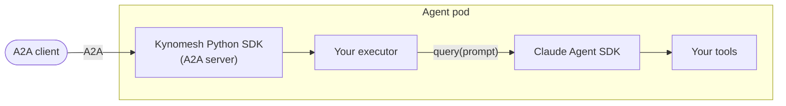

# Running Claude Agent SDK Agents on Kynomesh

These tutorials walk you through running agents built with the
[Claude Agent SDK](https://code.claude.com/docs/en/agent-sdk/python) on
Kynomesh, from a single agent with a custom tool to a supervisor that finds its
Claude workers on its own.

The Claude Agent SDK does not speak [A2A](https://a2a-protocol.org/), and it
does not need to. Kynomesh's Python SDK runs the A2A server and makes calls
between agents, and Claude is just what answers each message. You describe the
deployment in an [`AgentSet`](../../core-concepts/agentset.md), and Kynomesh
runs the agents and lets them call each other by name.



Multi-agent is not a requirement. A single agent already benefits from
autoscaling, zero-downtime rollouts and rate limiting, and it can grow into a
team later without code changes.

## The Tutorials

Each tutorial builds on the previous one and has a matching, runnable example in
the
[kynoproj/kynomesh-examples](https://github.com/kynoproj/kynomesh-examples/tree/main/claude-agent-sdk)
repository.

| Tutorial      | What you build                                                         | What you learn                                                                                                 |
| ------------- | ---------------------------------------------------------------------- | -------------------------------------------------------------------------------------------------------------- |
| [Single agent](./1-single-agent.md) | A conversational agent with a custom temperature-conversion tool.      | Serving a Claude Agent SDK agent over A2A, locking it down to run in a pod, and deploying it as an `AgentSet`. |
| [Dynamic peers](./2-dynamic-peers.md) | A travel-planning supervisor that finds its Claude workers at startup. | Adding or removing a worker without changing code, and keeping the supervisor in sync when a worker changes.   |

## What to Know About the Claude Agent SDK

A few things differ from a typical API-based agent, and they apply to every
tutorial here:

- **Each request starts the Claude Code CLI.** The SDK runs the CLI that ships
  inside the `claude-agent-sdk` package as a subprocess for each request. Expect
  a few seconds of startup per request, and a large container image (about 100
  MB for the CLI alone).
- **The agent must be locked down.** The CLI normally comes with built-in tools
  such as Bash, Read and Write. In a pod you disable them and allow only your
  own tools, so the examples configure this for you. The single-agent tutorial
  explains how.
- **It needs a writable home directory.** The CLI writes state under `$HOME`,
  and the example images run as an unprivileged user, so the Dockerfile points
  `HOME` at a writable directory.

## Prerequisites

- Python 3.10+ and [uv](https://docs.astral.sh/uv/)
- An `ANTHROPIC_API_KEY`
- [`a2acli`](../../user-guide/reference/a2acli.md) to send messages from the
  command line
- Docker, `kubectl`, and a local Kubernetes cluster with Kynomesh installed.
  Follow the [Quick Start](../../quick-start.md) if you have not set one up.

## Get the Examples

```shell
git clone https://github.com/kynoproj/kynomesh-examples.git
cd kynomesh-examples/claude-agent-sdk
```

Each example is self-contained and works the same way:

| Path / target | Purpose                              |
| ------------- | ------------------------------------ |
| `src/`        | Your agent code and its A2A wrapper. |
| `manifests/`  | The `AgentSet` to deploy.            |
| `tests/`      | Unit tests. They make no API calls.  |
| `make build`  | Build the container image.           |
| `make deploy` | Deploy the `AgentSet`.               |
| `make delete` | Remove it.                           |

## Before You Deploy

- Create the API key secret the manifests read:

  ```shell
  kubectl create secret generic anthropic-api-key --from-literal=ANTHROPIC_API_KEY=...
  ```

- Load the image into your cluster after `make build`. With kind, run
  `kind load docker-image <image>`; with k3d, run
  `k3d image import <image> -c <cluster>`.

> [!TIP] Behind a TLS-intercepting proxy the image build fails certificate
> checks. Pass the proxy CA with `make build CA_CERT=/path/to/ca.pem`.

## Troubleshooting

- **`no compatible transports found` from `a2acli`:** set `protocol_version` on
  each interface in your agent's `AgentCard`. The examples use
  `PROTOCOL_VERSION_CURRENT` from `a2a.utils.constants`.
- **Pods stay in `ImagePullBackOff` or `CreateContainerConfigError`:** the image
  was not loaded into the cluster, or the `anthropic-api-key` secret is missing.

## Mixing Frameworks

Agents in one `AgentSet` only see each other's `AgentCard`s and A2A endpoints,
so they do not need to use the same framework. The
[mixed-fleet](https://github.com/kynoproj/kynomesh-examples/tree/main/mixed-fleet)
example runs a Claude supervisor that delegates to both
[LangGraph](../langgraph/0-overview.md) and Claude workers.

## Next Steps

Start with the [Single agent](./1-single-agent.md) tutorial.
