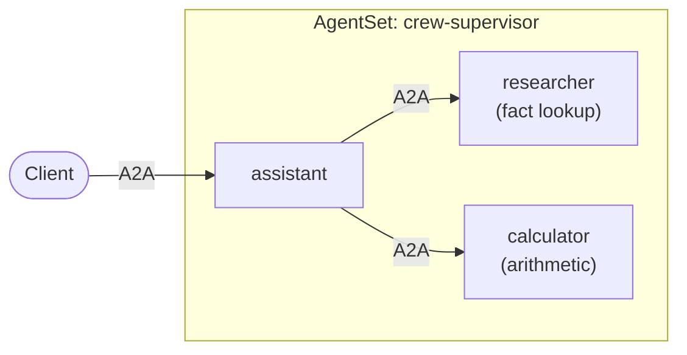

# Tutorial: A Supervisor with Two Workers

In this tutorial you build a team of three [CrewAI](https://docs.crewai.com/)
agents: a **supervisor** that takes a question and delegates to two workers, a
**researcher** that looks up facts and a **calculator** that does arithmetic.
Each agent runs in its own pod and the supervisor calls the workers by name.



The entry agent is named `assistant`. With `pattern: Supervisor` it acts as the
supervisor: it sees every other agent and delegates to them.

Splitting work this way lets each agent have a focused role and its own tools.
It also lets each one scale independently, so a busy worker can grow while the
others stay small.

This tutorial builds on [Single agent](./1-single-agent.md). The full example is
in
[kynoproj/kynomesh-examples](https://github.com/kynoproj/kynomesh-examples/tree/main/crewai/supervisor).

```shell
git clone https://github.com/kynoproj/kynomesh-examples.git
cd kynomesh-examples/crewai/supervisor
```

## What's in the Example

| File                             | Purpose                                                                       |
| -------------------------------- | ----------------------------------------------------------------------------- |
| `src/crew_assistant/agents.py`   | The three CrewAI agents, and `run_agent`.                                     |
| `src/crew_assistant/tools.py`    | The workers' tools: a small knowledge base and `add`/`multiply`/`divide`.     |
| `src/crew_assistant/peers.py`    | `ask_peer`, which calls another agent by name, and `blocking_ask` for CrewAI. |
| `src/crew_assistant/executor.py` | Serves a CrewAI agent over A2A, the same wrapper as in the last tutorial.     |
| `src/crew_assistant/main.py`     | Starts one agent. `--role` picks which.                                       |
| `manifests/agentset.yaml`        | One image deployed as three agents.                                           |

## The Workers

The workers are ordinary CrewAI agents with a role and some tools. They know
nothing about Kynomesh or about the supervisor:

```python
def build_researcher(llm: LLM | None = None) -> Agent:
    return _agent(
        llm,
        role="Research expert",
        goal="Answer factual questions",
        backstory=(
            "Use the lookup_fact tool to answer factual questions. "
            "Reply with the facts only; do not do arithmetic."
        ),
        tools=RESEARCHER_TOOLS,
    )
```

The calculator is built the same way, with `add`, `multiply` and `divide`. The
researcher's only tool, `lookup_fact`, reads from a tiny built-in knowledge base
covering France, Japan, Kubernetes and A2A.

> [!NOTE] Ask the researcher about anything outside that knowledge base and it
> answers "No facts found". The tool is a stand-in for a real search or
> database.

## The Supervisor

The supervisor is also a normal CrewAI agent. Its tools are the workers: each
tool forwards a question to a worker by name.

```python
@tool("ask_researcher")
def ask_researcher(question: str) -> str:
    """Ask the researcher worker a factual question."""
    return delegate("researcher", question)


@tool("ask_calculator")
def ask_calculator(problem: str) -> str:
    """Ask the calculator worker to solve an arithmetic problem."""
    return delegate("calculator", problem)
```

A worker that fails comes back to the supervisor as an error string instead of
raising, so it can answer around the failure:

```python
def delegate(worker: str, request: str) -> str:
    try:
        return ask_peer(worker, request)
    except Exception as e:
        return f"Error: worker {worker!r} failed: {e}"
```

The supervisor's `backstory` tells it to delegate rather than answer itself, and
to call both workers in turn when a question needs both:

```python
backstory=(
    "You have two workers: the researcher (facts) and the calculator (arithmetic). "
    "Delegate with the ask_researcher and ask_calculator tools; call both, one after "
    "the other, when a question needs both. Never answer facts or math yourself. "
    "Finish with a short final answer."
),
```

## Calling a Peer by Name

`ask_peer` is the only place the agents talk to each other. It asks the Kynomesh
SDK for a client for the peer and sends it a message:

```python
async def ask_peer(name: str, text: str) -> str:
    a2a_client = await client.peer_client(name)
    request = SendMessageRequest(
        message=Message(
            message_id=str(uuid.uuid4()),
            role=Role.ROLE_USER,
            parts=[Part(text=text)],
        )
    )
    chunks: list[str] = []
    async for response in a2a_client.send_message(request):
        chunks.extend(part.text for part in response.message.parts)
    return "".join(chunks)
```

`name` is the agent's name in the `AgentSet`, such as `researcher`. There are no
URLs, ports or service names in your code. CrewAI also has its own A2A support,
but this example does not use it: to CrewAI, a worker is just another tool.

## Calling a Peer from a CrewAI Tool

There is one CrewAI-specific wrinkle. `ask_peer` is an `async` function, but the
supervisor's tools are plain functions. CrewAI runs every tool, sync or async,
on a worker thread with its own event loop. The Kynomesh client caches its peer
connections for the server's event loop, so a tool cannot just `await` it.

The example bridges the two with `blocking_ask`. It hands the call back to the
server's event loop and waits for the reply:

```python
def blocking_ask(ask, loop, *, timeout: float = PEER_TIMEOUT):
    def call(name: str, text: str) -> str:
        ...
        future = asyncio.run_coroutine_threadsafe(ask(name, text), loop)
        return future.result(timeout)

    return call
```

`main.py` captures the server's loop and wraps `ask_peer` with it when it builds
the supervisor:

```python
loop = asyncio.get_running_loop()
agent = agents.build_supervisor(blocking_ask(ask_peer, loop))
```

A few details are worth knowing:

- The call waits up to 120 seconds for a worker's reply, then raises a timeout
  that the supervisor sees as an error string.
- If it were ever called on the server's own event loop thread, it raises an
  error instead of deadlocking.
- The workers do not need any of this, because they only answer requests and
  call no one.

If you add a CrewAI tool of your own that calls another agent, call it through
`blocking_ask` the same way.

## One Image, Three Agents

All three agents come from the same image. `main.py` reads a `--role` argument
and builds the matching agent and `AgentCard`:

```python
def build_agent(role: str, loop: asyncio.AbstractEventLoop) -> Agent:
    if role == "assistant":
        return agents.build_supervisor(blocking_ask(ask_peer, loop))
    if role == "researcher":
        return agents.build_researcher()
    if role == "calculator":
        return agents.build_calculator()
```

Sharing one image keeps the example simple. In your own project each agent can
have its own image, and even its own language.

## The AgentSet

The manifest declares the three agents and how they relate:

```yaml
apiVersion: kynomesh.kyno.sh/v1alpha1
kind: AgentSet
metadata:
  name: crew-supervisor
spec:
  pattern: Supervisor
  entry: assistant
  agents:
    - name: assistant
      container:
        image: crew-supervisor:latest
        imagePullPolicy: IfNotPresent
        args: ["--role", "assistant"]
        env: &openai-env
          - name: OPENAI_API_KEY
            valueFrom:
              secretKeyRef:
                name: openai-api-key
                key: OPENAI_API_KEY
    - name: researcher
      container:
        image: crew-supervisor:latest
        imagePullPolicy: IfNotPresent
        args: ["--role", "researcher"]
        env: *openai-env
    - name: calculator
      container:
        image: crew-supervisor:latest
        imagePullPolicy: IfNotPresent
        args: ["--role", "calculator"]
        env: *openai-env
```

Two fields shape the team:

- `entry: assistant` makes the assistant the agent that outside callers reach.
- `pattern: Supervisor` lets the entry agent call every other agent, while the
  workers can call no one. That is why `ask_peer("researcher", ...)` works in
  the supervisor and would not work in a worker.

Kynomesh also supports
[other patterns](../../core-concepts/agentset.md#patterns) such as `Handoff` and
`Sequential`.

## Run the Tests

You need Python 3.10 to 3.13. Run:

```shell
uv run pytest
```

The tests mock the model and the calls between agents, so they need no API key
or cluster.

> [!NOTE] The supervisor can only reach its workers on Kynomesh, so you cannot
> try the whole team on your laptop. A single worker does run locally:
>
> ```shell
> OPENAI_API_KEY=... uv run python -m crew_assistant.main --role calculator
> a2acli -u http://localhost:8088 send 'What is 68 * 3?'
> ```

## Deploy to Kynomesh

Build the image, load it into your cluster, create the secret, and deploy:

```shell
make build
# kind:  kind load docker-image crew-supervisor:latest
# k3d:   k3d image import crew-supervisor:latest -c <cluster>
kubectl create secret generic openai-api-key --from-literal=OPENAI_API_KEY=...
make deploy
```

Wait until the `AgentSet` is `Running` and the three agents are ready:

```shell
kubectl get agentset,agentdeploy
```

## Talk to the Team

Forward the entry agent's service to your machine:

```shell
kubectl port-forward svc/crew-supervisor-ingress 8490
```

First ask something that needs one worker:

```shell
a2acli -k -u https://localhost:8490 --override-host=localhost:8490 \
  send 'What is the capital of France?'
```

The supervisor asks the researcher and replies with Paris. Then ask something
that needs both:

```shell
a2acli -k -u https://localhost:8490 --override-host=localhost:8490 \
  send 'What is the population of France multiplied by 3?'
```

The supervisor asks the researcher for France's population (about 68 million),
then asks the calculator to multiply it by 3.

To see the delegation happen, list the pods and read a worker's logs while you
send the second question:

```shell
kubectl get pods
kubectl logs -f <researcher-pod> -c agent
```

## Clean Up

```shell
make delete
```

## Make It Your Own

- **Change the workers.** Replace the tools in `tools.py`, or the whole worker
  agent, with your own. The supervisor only needs a tool that calls the worker
  by name.
- **Add a worker.** Add an agent to the `AgentSet`, give the supervisor a tool
  that calls it through `blocking_ask`, and update the supervisor's `backstory`.
  The next tutorial, [Dynamic peers](./3-dynamic-peers.md), removes even that
  last step.
- **Scale one agent.** Workers scale independently of the supervisor. See
  [Autoscaling](../../user-guide/reference/autoscaling.md).

## Troubleshooting

- **The supervisor answers "No facts found":** the researcher's knowledge base
  only covers France, Japan, Kubernetes and A2A. Ask about one of those.
- **`no compatible transports found`:** every `AgentInterface` in each agent's
  card needs `protocol_version` set.
- **An agent is not ready:** run `kubectl get pods` and check the image was
  loaded into the cluster and the `openai-api-key` secret exists.
- **The supervisor reports that a worker failed or timed out:** read that
  worker's logs with `kubectl logs`. The failure comes back to the model as an
  error string rather than crashing the run.
- **A tool you added hangs or fails when it calls another agent:** call the peer
  through `blocking_ask`, as the supervisor's tools do.

## Next Steps

The supervisor in this tutorial names its workers in code. In the next tutorial,
[Dynamic peers](./3-dynamic-peers.md), it discovers them instead.
