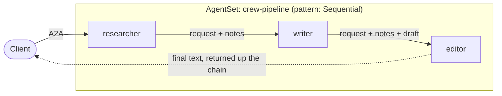

# Tutorial: A Sequential Pipeline

In the earlier tutorials one agent, the supervisor, decided who to call. Here
you build a pipeline instead, where each agent does its part and hands the work
to the next one. It is a three-stage [CrewAI](https://docs.crewai.com/) pipeline
on Kynomesh's `Sequential` pattern: a **researcher** gathers facts, a **writer**
drafts from them, and an **editor** tightens the draft. Each stage runs in its
own pod.



You send one request to the first stage. The text flows down the chain, and the
editor's answer comes back up to you.

This tutorial builds on [Single agent](./1-single-agent.md). The full example is
in
[kynoproj/kynomesh-examples](https://github.com/kynoproj/kynomesh-examples/tree/main/crewai/sequential).

```shell
git clone https://github.com/kynoproj/kynomesh-examples.git
cd kynomesh-examples/crewai/sequential
```

## The Sequential Pattern

The `pattern` field of an `AgentSet` controls who each agent is allowed to call.
With `pattern: Sequential`:

- Each agent sees **only the next agent**, in the order they are declared in the
  manifest. The last agent sees nobody.
- The `entry` must be the first agent.

So the manifest is the pipeline. A stage's code never names the stage after it:
it asks Kynomesh who is next. See
[AgentSet](../../core-concepts/agentset.md#patterns) for the other patterns.

## What's in the Example

| File                            | Purpose                                                                                  |
| ------------------------------- | ---------------------------------------------------------------------------------------- |
| `src/crew_pipeline/pipeline.py` | `next_stage` (who comes next, from Kynomesh) and `chain` (do the work, forward, return). |
| `src/crew_pipeline/stages.py`   | The stages the image can run (`researcher`, `writer`, `editor`) and their instructions.  |
| `src/crew_pipeline/agent.py`    | `build_agent` and `run_agent`: the CrewAI setup shared by every stage.                   |
| `src/crew_pipeline/peers.py`    | `ask_peer`, which calls the next stage by name.                                          |
| `src/crew_pipeline/tools.py`    | `lookup_fact` for the researcher and `word_count` for the editor.                        |
| `src/crew_pipeline/main.py`     | Starts one stage. `--role` picks which.                                                  |
| `manifests/agentset.yaml`       | One image deployed as three agents, in order.                                            |

## The Stages

Each stage is an ordinary CrewAI agent with an instruction, and the three are
defined in one table:

```python
STAGES: dict[str, StageSpec] = {
    "researcher": StageSpec(
        name="Researcher",
        description="Gathers the key facts about a topic",
        instruction=(
            "You research the topic in the request. Use lookup_fact, then reply with a short "
            "bulleted list of the key facts. Do not write the article."
        ),
        tools=(lookup_fact,),
        output_label="Research notes",
        ...
    ),
    "writer": StageSpec(... output_label="Draft", ...),
    "editor": StageSpec(... output_label="Final text", ...),
}
```

The researcher uses a tiny built-in knowledge base covering Kubernetes, A2A,
Japan and France. The editor has a `word_count` tool to keep its text under 60
words. `output_label` is the heading the stage puts on its work when it hands it
on.

> [!NOTE] Ask about anything outside the researcher's knowledge base and it
> reports "No facts found", and the later stages work from that. The tool is a
> stand-in for a real search or database.

## Finding the Next Stage

When a stage starts, it asks Kynomesh who comes next. Under the `Sequential`
pattern that is at most one peer:

```python
def next_stage(list_peers=client.peers) -> str | None:
    try:
        peers = list_peers()
    except client.TopologyNotAvailableError:
        _logger.warning("no Kynomesh topology: running as a standalone stage")
        return None
    if len(peers) > 1:
        raise ValueError(f"a Sequential stage has at most one next stage; got {sorted(peers)}")
    return peers[0] if peers else None
```

The researcher and the writer each get one peer, and the editor gets none, which
is how the editor knows it is last. Outside a cluster there is no topology, so a
stage runs on its own, which lets you try one stage on your laptop.

## Doing the Work and Handing It On

`chain` wraps a stage's work. The stage runs its agent, then forwards the result
to the next stage, if there is one, and returns whatever that stage returns:

```python
def chain(*, stage_run, label, next_peer, ask_peer):
    async def run(received: str) -> str:
        output = await stage_run(received)
        if next_peer is None:
            return output
        return await ask_peer(next_peer, handoff_message(received, label, output))

    return run
```

Three things follow from this:

- **The reply travels back up.** Each stage returns its successor's answer, so
  the client that called the researcher gets the editor's text.
- **The message grows into a transcript.** A stage forwards what it received
  plus its own labelled output:

  ```python
  def handoff_message(received: str, label: str, output: str) -> str:
      return f"{received}\n\n{label}:\n{output}"
  ```

  So the editor sees the request, the research notes and the draft. Nothing is
  parsed back out, and multi-paragraph requests survive intact.

- **A failing stage fails the request.** A supervisor can answer around a broken
  worker, but a pipeline has nothing to return without its later stages. A
  downstream error propagates back up to the caller.

> [!NOTE] The hand-off happens in the stage's own handler, not inside a CrewAI
> tool, and it is awaited on the server's event loop. So the `blocking_ask`
> bridge from the
> [Supervisor](./2-supervisor.md#calling-a-peer-from-a-crewai-tool) tutorial is
> not needed here.

## One Image, Three Agents

All three stages come from the same image. `main.py` reads a `--role` argument,
builds that stage's agent, and wraps it with `chain`:

```python
def build_stage(role: str) -> Run:
    spec = STAGES[role]
    agent = build_agent(role=spec.name, instruction=spec.instruction, tools=spec.tools)
    next_peer = next_stage()

    async def stage_run(request: str) -> str:
        return await run_agent(request, agent=agent)

    return chain(stage_run=stage_run, label=spec.output_label, next_peer=next_peer, ask_peer=ask_peer)
```

## The AgentSet

The manifest lists the stages in order:

```yaml
apiVersion: kynomesh.kyno.sh/v1alpha1
kind: AgentSet
metadata:
  name: crew-pipeline
spec:
  pattern: Sequential
  entry: researcher
  agents:
    - name: researcher
      container:
        image: crew-pipeline:latest
        imagePullPolicy: IfNotPresent
        args: ["--role", "researcher"]
        env: &openai-env
          - name: OPENAI_API_KEY
            valueFrom:
              secretKeyRef:
                name: openai-api-key
                key: OPENAI_API_KEY
    - name: writer
      container:
        image: crew-pipeline:latest
        imagePullPolicy: IfNotPresent
        args: ["--role", "writer"]
        env: *openai-env
    - name: editor
      container:
        image: crew-pipeline:latest
        imagePullPolicy: IfNotPresent
        args: ["--role", "editor"]
        env: *openai-env
```

The order of `agents` is the order of the pipeline, and `entry` is the first
stage. Because a stage never names its successor, reordering or inserting agents
in the manifest changes the chain with no code change.

## Run the Tests

You need Python 3.10 to 3.13. Run:

```shell
uv run pytest
```

The tests mock the model and the calls between agents, so they need no API key
or cluster. One test wires all three real stages together in-process, with
scripted models, and follows a request down the chain and the answer back up.

You can also try one stage on its own, since outside a cluster it simply does
not forward:

```shell
OPENAI_API_KEY=... uv run python -m crew_pipeline.main --role editor
a2acli -u http://localhost:8088 send 'Draft: Kubernetes is a system that runs containers on many machines'
```

## Deploy to Kynomesh

Build the image, load it into your cluster, create the secret, and deploy:

```shell
make build
# kind:  kind load docker-image crew-pipeline:latest
# k3d:   k3d image import crew-pipeline:latest -c <cluster>
kubectl create secret generic openai-api-key --from-literal=OPENAI_API_KEY=...
make deploy
```

Wait until the `AgentSet` is `Running` and the three agents are ready:

```shell
kubectl get agentset,agentdeploy
```

## Send a Request Down the Pipeline

Forward the entry agent's service to your machine, and send the request to the
first stage:

```shell
kubectl port-forward svc/crew-pipeline-ingress 8490
```

```shell
a2acli -k -u https://localhost:8490 --override-host=localhost:8490 \
  send 'Write a short blurb about Kubernetes'
```

The reply is the editor's final text, a short blurb of under 60 words. To see
the hand-offs, read the stages' logs:

```shell
kubectl logs -l app.kubernetes.io/name=crew-pipeline-researcher -c agent | grep forwarding
```

The researcher logs that it forwarded its notes to `writer`. Check the writer's
logs the same way, with `crew-pipeline-writer`, to see it forward the draft to
`editor`.

## Clean Up

```shell
make delete
```

## Make It Your Own

- **Change the stages.** Edit the instructions and tools in `stages.py`, or add
  a stage to the table. Each stage only needs a name, an instruction, tools and
  an `output_label`.
- **Reorder or add agents.** Change the `agents` list in the manifest. Each
  stage finds its successor from Kynomesh, so the chain follows.
- **Use other frameworks for some stages.** A stage only needs to accept a
  message and reply, so any agent served over A2A can sit in the chain. See
  [Mixing Frameworks and Languages](../mixed-fleet.md).
- **Pick the right pattern.** Use `Sequential` when each step feeds the next.
  Use [`Supervisor`](./2-supervisor.md) when one agent decides who to call.

## Troubleshooting

- **A stage fails with "at most one next stage":** under `Sequential` each agent
  may see only one peer. Check the manifest uses `pattern: Sequential` and that
  `entry` is the first agent in `agents`.
- **The final text says "No facts found":** the researcher's knowledge base only
  covers Kubernetes, A2A, Japan and France. Ask about one of those.
- **The whole request fails:** a failing stage fails the request, because later
  stages have nothing to work from. Find the stage that failed with
  `kubectl logs`.
- **`no compatible transports found`:** every `AgentInterface` in each agent's
  card needs `protocol_version` set.
- **An agent is not ready:** run `kubectl get pods` and check the image was
  loaded into the cluster and the `openai-api-key` secret exists.

## Next Steps

You have now run a single CrewAI agent, two kinds of supervisor, and a
sequential pipeline. To run agents from different frameworks in one `AgentSet`,
see [Mixing Frameworks and Languages](../mixed-fleet.md), and to call an agent
that lives in another `AgentSet`, see [External Agent](../external-agent.md).
