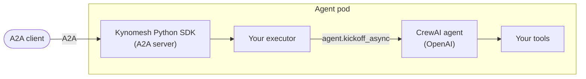

# Running CrewAI Agents on Kynomesh

These tutorials walk you through running agents built with
[CrewAI](https://docs.crewai.com/) on Kynomesh, from a single agent with a
custom tool to a supervisor that finds its workers on its own, and a pipeline
where each stage hands its work to the next.

CrewAI has its own [A2A](https://a2a-protocol.org/) support, both as a client
and as a server, but these examples do not use it. Kynomesh's Python SDK runs
the A2A server and makes calls between agents, and your CrewAI agent is just
what answers each message, with ordinary tools. You describe the deployment in
an [`AgentSet`](../../core-concepts/agentset.md), and Kynomesh runs the agents
and lets them call each other by name.



Multi-agent is not a requirement. A single agent already benefits from
autoscaling, zero-downtime rollouts and rate limiting, and it can grow into a
team later without code changes.

## The Tutorials

Each tutorial has a matching, runnable example in the
[kynoproj/kynomesh-examples](https://github.com/kynoproj/kynomesh-examples/tree/main/crewai)
repository. The first three build on each other. The pipeline stands on its own,
though it helps to read the first tutorial before it.

| Tutorial                              | What you build                                                              | What you learn                                                                                               |
| ------------------------------------- | --------------------------------------------------------------------------- | ------------------------------------------------------------------------------------------------------------ |
| [Single agent](./1-single-agent.md)   | A conversational agent with a custom temperature-conversion tool.           | Serving a CrewAI agent over A2A and deploying it as an `AgentSet`.                                           |
| [Supervisor](./2-supervisor.md)       | A supervisor that delegates to a researcher and a calculator, one pod each. | Splitting work across agents, and calling a peer from a CrewAI tool.                                         |
| [Dynamic peers](./3-dynamic-peers.md) | A travel-planning supervisor that finds its workers at startup.             | Adding or removing a worker without changing code, and keeping the supervisor in sync when a worker changes. |
| [Sequential](./4-sequential.md)       | A researcher, writer and editor pipeline, one pod per stage.                | The `Sequential` pattern: each stage hands its work to the next, and the final text returns up the chain.    |

## What to Know About CrewAI

A few things apply to every tutorial here:

- **Each agent answers with `kickoff_async`.** The examples use a standalone
  CrewAI `Agent`, so there is no `Task` or `Crew` to wire up, and each request
  starts from a clean conversation.
- **The agents run on OpenAI by default.** Set `OPENAI_API_KEY`, and optionally
  `OPENAI_MODEL` (the examples default to `gpt-4o-mini`). Other providers work
  through CrewAI's `LLM`.
- **CrewAI needs a writable home and likes to phone home.** It draws progress
  panels to stdout, keeps state under `$HOME`, and sends telemetry by default.
  The examples silence the panels, and their Dockerfiles give the unprivileged
  user a writable home and turn telemetry and tracing off.
- **CrewAI needs Python 3.10 to 3.13.** It does not support 3.14 yet, so the
  examples pin the Python version.
- **Tools run on their own thread.** CrewAI runs tools on a worker thread with
  its own event loop, which matters when a tool calls another agent. The
  supervisor tutorial explains how the example handles it.

## Prerequisites

- Python 3.10 to 3.13 and [uv](https://docs.astral.sh/uv/)
- An `OPENAI_API_KEY`
- [`a2acli`](../../user-guide/reference/a2acli.md) to send messages from the
  command line
- Docker, `kubectl`, and a local Kubernetes cluster with Kynomesh installed.
  Follow the [Quick Start](../../quick-start.md) if you have not set one up.

## Get the Examples

```shell
git clone https://github.com/kynoproj/kynomesh-examples.git
cd kynomesh-examples/crewai
```

Each example is self-contained and works the same way:

| Path / target | Purpose                              |
| ------------- | ------------------------------------ |
| `src/`        | Your agent code and its A2A wrapper. |
| `manifests/`  | The `AgentSet` to deploy.            |
| `tests/`      | Unit tests. They make no API calls.  |
| `make build`  | Build the container image.           |
| `make deploy` | Deploy the `AgentSet`.               |
| `make delete` | Remove it.                           |

## Before You Deploy

- Create the API key secret the manifests read:

  ```shell
  kubectl create secret generic openai-api-key --from-literal=OPENAI_API_KEY=...
  ```

- Load the image into your cluster after `make build`. With kind, run
  `kind load docker-image <image>`; with k3d, run
  `k3d image import <image> -c <cluster>`.

> [!TIP] Behind a TLS-intercepting proxy the image build fails certificate
> checks. Pass the proxy CA with `make build CA_CERT=/path/to/ca.pem`.

## Troubleshooting

- **`no compatible transports found` from `a2acli`:** set `protocol_version` on
  each interface in your agent's `AgentCard`. The examples use
  `PROTOCOL_VERSION_CURRENT` from `a2a.utils.constants`.
- **Pods stay in `ImagePullBackOff` or `CreateContainerConfigError`:** the image
  was not loaded into the cluster, or the `openai-api-key` secret is missing.
- **The build or install fails on Python 3.14:** use Python 3.10 to 3.13.

## Mixing Frameworks

Agents in one `AgentSet` only see each other's `AgentCard`s and A2A endpoints,
so they do not need to use the same framework. See
[Mixing Frameworks and Languages](../mixed-fleet.md) for an example that runs
agents from different frameworks together.

## Next Steps

Start with the [Single agent](./1-single-agent.md) tutorial.
