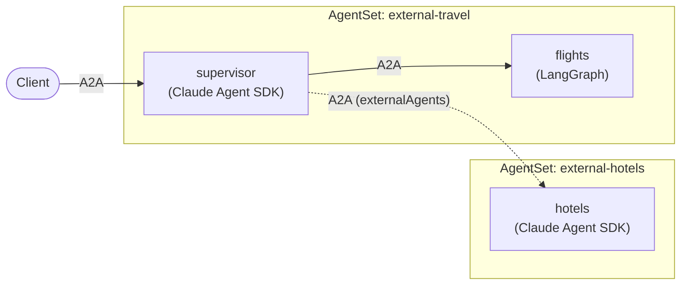

# Tutorial: Calling an Agent in Another AgentSet

Not every agent your team needs lives in your `AgentSet`. Another team may run
its own `AgentSet`, or an agent may already run elsewhere and just need to be
called. Kynomesh lets you reference such an agent as an **external agent**:
nothing is deployed for it in your `AgentSet`, but your agents can call it like
any other peer.

In this tutorial you deploy two `AgentSets`. The first has a travel supervisor
and a `flights` worker. The second has a `hotels` worker. The supervisor uses
both without knowing that `hotels` lives somewhere else.



The full example is in
[kynoproj/kynomesh-examples](https://github.com/kynoproj/kynomesh-examples/tree/main/external-agent).
It builds on the Dynamic peers tutorials, so read
[LangGraph](./langgraph/3-dynamic-peers.md) or
[Claude Agent SDK](./claude-agent-sdk/2-dynamic-peers.md) first if you have not.

```shell
git clone https://github.com/kynoproj/kynomesh-examples.git
cd kynomesh-examples/external-agent
```

## What Is an External Agent?

An external agent is a name and a URL declared in `externalAgents`. Kynomesh
creates no pod, no broker, and no scaling or probing for it. It adds the agent
to the entry agent's peers, like any other.

- **Your agents need no code change.** The supervisor discovers `hotels` from
  its topology and `AgentCard`, and cannot tell it is external.
- **It is called, never the entry.** An external agent can be a worker but not
  the `entry` of your `AgentSet`.
- **The other side stays in charge.** The `AgentSet` that owns the agent keeps
  managing its pods, scaling and updates.

See [External Agents](../user-guide/reference/configuration/external-agents.md)
for the full rules for each pattern.

## What's in the Example

There is no new agent code. The manifests reuse the images built by the two
Dynamic peers examples, choosing the agent with `--role`:

| Agent                               | Framework        | Image              |
| ----------------------------------- | ---------------- | ------------------ |
| `supervisor`                        | Claude Agent SDK | `claude-travel`    |
| `hotels` (external, own `AgentSet`) | Claude Agent SDK | `claude-travel`    |
| `flights`                           | LangGraph        | `langgraph-travel` |

| File                             | Purpose                                                           |
| -------------------------------- | ----------------------------------------------------------------- |
| `manifests/hotels-agentset.yaml` | `hotels`, deployed as its own `AgentSet`.                         |
| `manifests/agentset.yaml`        | The supervisor and `flights`, with `hotels` as an external agent. |

## The Other AgentSet

`hotels` is deployed on its own, exactly like any single-agent `AgentSet`:

```yaml
apiVersion: kynomesh.kyno.sh/v1alpha1
kind: AgentSet
metadata:
  name: external-hotels
spec:
  pattern: Supervisor
  entry: hotels
  agents:
    - name: hotels
      container:
        image: claude-travel:latest
        imagePullPolicy: IfNotPresent
        args: ["--role", "hotels"]
        env:
          - name: ANTHROPIC_API_KEY
            valueFrom:
              secretKeyRef:
                name: anthropic-api-key
                key: ANTHROPIC_API_KEY
```

It knows nothing about the supervisor, and does not need to.

## Referencing It as an External Agent

The travel `AgentSet` declares `hotels` under `externalAgents`:

```yaml
apiVersion: kynomesh.kyno.sh/v1alpha1
kind: AgentSet
metadata:
  name: external-travel
spec:
  pattern: Supervisor
  entry: supervisor
  agents:
    - name: supervisor
      container:
        image: claude-travel:latest
        imagePullPolicy: IfNotPresent
        args: ["--role", "supervisor"]
        env:
          - name: ANTHROPIC_API_KEY
            valueFrom:
              secretKeyRef:
                name: anthropic-api-key
                key: ANTHROPIC_API_KEY
          - name: KYNOMESH_INSECURE_TLS_PEERS
            value: hotels
    - name: flights
      container:
        image: langgraph-travel:latest
        imagePullPolicy: IfNotPresent
        args: ["--role", "flights"]
        env:
          - name: OPENAI_API_KEY
            valueFrom:
              secretKeyRef:
                name: openai-api-key
                key: OPENAI_API_KEY
  externalAgents:
    - name: hotels
      url: https://external-hotels-hotels:8490
```

Two parts are new compared with the earlier tutorials.

**The URL.** An agent in another `AgentSet` is served at
`https://<agentset>-<agent>:8490`, here `external-hotels-hotels`. Within one
namespace the short name works. To call across namespaces, add the namespace:
`https://<agentset>-<agent>.<namespace>.svc:8490`.

**The TLS setting.** Peers inside an `AgentSet` are reached over each broker's
self-signed certificate, and the Kynomesh SDK skips verification for them. An
external peer is expected to present a CA-signed certificate, so the SDK
verifies it. But the `hotels` broker is self-signed too, so verification would
fail with `CERTIFICATE_VERIFY_FAILED`. Listing `hotels` in
`KYNOMESH_INSECURE_TLS_PEERS` gives it the same treatment as a peer in your own
`AgentSet`: the connection is encrypted, but the peer is not authenticated.

> [!WARNING] `KYNOMESH_INSECURE_TLS_PEERS` is for agents you operate. Leave it
> out for a real external agent that presents a CA-signed certificate, so the
> SDK keeps verifying it. See
> [Calling an agent in another AgentSet](../user-guide/reference/configuration/external-agents.md#calling-an-agent-in-another-agentset-tls).

The `AgentSet` has no `pattern` change: under `Supervisor`, the entry agent sees
every other agent, including external ones.

## Deploy to Kynomesh

You need both an `ANTHROPIC_API_KEY` and an `OPENAI_API_KEY`, because the
example uses both kinds of agent.

```shell
make build                     # builds langgraph-travel and claude-travel
# kind:  kind load docker-image langgraph-travel:latest claude-travel:latest
# k3d:   k3d image import langgraph-travel:latest claude-travel:latest -c <cluster>
kubectl create secret generic anthropic-api-key --from-literal=ANTHROPIC_API_KEY=...
kubectl create secret generic openai-api-key --from-literal=OPENAI_API_KEY=...
make deploy
```

`make deploy` applies the hotels `AgentSet` first, then the travel one that
calls it. Check both are running, and which `AgentSet` owns each agent:

```shell
kubectl get agentset       # two AgentSets, both Running
kubectl get agentdeploy    # hotels belongs to external-hotels
```

## Talk to the Team

Forward the travel `AgentSet`'s ingress and plan a trip:

```shell
kubectl port-forward svc/external-travel-ingress 8490
```

The supervisor logs the workers it found. `hotels` is in the list even though it
is deployed elsewhere:

```shell
kubectl logs -l app.kubernetes.io/name=external-travel-supervisor -c agent | grep discovered
```

```shell
a2acli -k -u https://localhost:8490 --override-host=localhost:8490 \
  send 'Plan a weekend in Tokyo: flights from SFO and a hotel'
```

The answer combines `flights` from this `AgentSet` and `hotels` from the other
one. To see the call arrive on the other side, read the hotels agent's logs:

```shell
kubectl logs -l app.kubernetes.io/name=external-hotels-hotels -c agent
```

## Sending Credentials to an External Agent

The `hotels` agent in this example accepts any caller. A real external agent
usually does not: it wants an `Authorization` header or an API key, and may
require it just to read its `AgentCard` too. Kynomesh's `externalAgents` carries
only a name and a URL, so your agent supplies the credentials itself. This is not
part of the example, but it is a small change to `ask_peer` in `peers.py`, which
is where the supervisor calls a worker.

First, store the credential in a Secret and expose it to the supervisor as an
environment variable, next to the existing settings:

```shell
kubectl create secret generic hotels-token --from-literal=token=...
```

```yaml
env:
  - name: HOTELS_TOKEN
    valueFrom:
      secretKeyRef:
        name: hotels-token
        key: token
```

Then send it for the `hotels` peer only:

```python
from a2a.client.client import ClientCallContext

async def ask_peer(name: str, text: str) -> str:
    token = os.environ.get("HOTELS_TOKEN") if name == "hotels" else None
    auth = {"Authorization": f"Bearer {token}"} if token else None

    # Sent when the card is read, which happens the first time the client is built.
    a2a_client = await client.peer_client(name, card_headers=auth)

    # Sent on every call.
    context = ClientCallContext(service_parameters=auth) if auth else None
    async for response in a2a_client.send_message(request, context=context):
        ...
```

There are two different places the credential goes:

- **`card_headers`** is sent only on the request that reads the peer's card. Skip
  it if the card is public. It is applied when the client is first built and
  ignored afterwards, so after rotating a token, call `client.forget_peer("hotels")`
  to rebuild.
- **The call context** is sent on each call. Reading the token for every call
  lets you rotate it without rebuilding the client.

Only `hotels` carries the token, so your other workers never see it. For the Go
version, the rules for header names, and TLS considerations, see
[Passing headers and credentials](../user-guide/reference/configuration/external-agents.md#passing-headers-and-credentials).

> [!NOTE] `card_headers` needs Python SDK 0.1.2 or newer, or Go SDK 0.2.2 or
> newer (`PeerClientWithCardHeaders`).

## Clean Up

```shell
make delete
```

This removes both `AgentSets`.

## Use It for Your Own Agents

- **Agents owned by another team.** Reference their `AgentSet`'s agent by
  `<agentset>-<agent>` and let them keep deploying and scaling it.
- **A real external endpoint.** Use the endpoint's HTTPS URL and leave out
  `KYNOMESH_INSECURE_TLS_PEERS`, so its CA-signed certificate is verified. Send
  any credentials it needs as headers from your agent code, as shown
  [above](#sending-credentials-to-an-external-agent).
- **Pick the right pattern.** An external agent works well as a worker under
  `Supervisor`. Under `Sequential` it can only be the last step. See
  [External Agents](../user-guide/reference/configuration/external-agents.md#per-pattern-behavior).

## Troubleshooting

- **`CERTIFICATE_VERIFY_FAILED` when calling `hotels`:** the peer's broker is
  self-signed. Add its name to `KYNOMESH_INSECURE_TLS_PEERS` on the calling
  agent.
- **The supervisor does not list `hotels`:** deploy the hotels `AgentSet` first,
  and check the `externalAgents` URL points at `<agentset>-<agent>`.
- **The call cannot connect from another namespace:** use the long form
  `https://<agentset>-<agent>.<namespace>.svc:8490`.
- **`CreateContainerConfigError`:** one of the two secrets is missing.
- **A 401 or 403 when building the client for an external agent:** the peer
  protects its `AgentCard`. Pass `card_headers` (Python) or use
  `PeerClientWithCardHeaders` (Go), as shown
  [above](#sending-credentials-to-an-external-agent).

## Next Steps

To see how agents built with different frameworks work together in one
`AgentSet`, read [Mixing Frameworks and Languages](./mixed-fleet.md).
