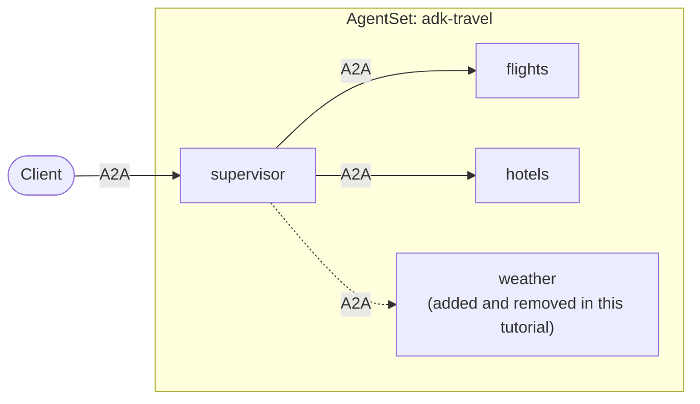

# Tutorial: An ADK Supervisor That Discovers Its Workers

In this tutorial you build a travel-planning supervisor with
[Google ADK](https://google.github.io/adk-docs/) whose workers are **not named
in its code**. At startup it asks Kynomesh who its workers are, reads what each
one can do, and generates one tool per worker. The workers are ADK agents too.

Add or remove a worker in the `AgentSet` and the supervisor picks it up, with no
code change and no new image.



This tutorial builds on [Single agent](./1-single-agent.md) and
[Supervisor](./2-supervisor.md). The discovery idea is the same as in the
[LangGraph version](../langgraph/3-dynamic-peers.md); this page shows how it
looks with ADK tools. The full example is in
[kynoproj/kynomesh-examples](https://github.com/kynoproj/kynomesh-examples/tree/main/google-adk/dynamic-peers).

```shell
git clone https://github.com/kynoproj/kynomesh-examples.git
cd kynomesh-examples/google-adk/dynamic-peers
```

## What's in the Example

| File                                   | Purpose                                                                    |
| -------------------------------------- | -------------------------------------------------------------------------- |
| `src/adk_travel/discovery.py`          | Finds the supervisor's workers and reads each one's `AgentCard`.           |
| `src/adk_travel/supervisor.py`         | Builds one tool per worker, and the instruction's worker list, from cards. |
| `src/adk_travel/agent.py`              | The ADK setup shared by every role.                                        |
| `src/adk_travel/workers.py`            | The worker roles the image can run: `flights`, `hotels` and `weather`.     |
| `src/adk_travel/main.py`               | Starts the supervisor or a worker. `--role` picks which.                   |
| `manifests/agentset.yaml`              | The supervisor, `flights` and `hotels`.                                    |
| `manifests/agentset-with-weather.yaml` | The same, plus `weather`.                                                  |

The workers use stub tools with canned data, so the example needs no travel API.

## How Discovery Works

An agent's `AgentCard` describes what it is and what it can do. Each worker
already publishes one, so the supervisor learns about its workers by reading
their cards instead of being told about them.

`discovery.py` lists the supervisor's peers, then reads each peer's card:

```python
async def discover_workers() -> tuple[WorkerInfo, ...]:
    workers = []
    for name in sorted(client.peers()):
        card = await client.resolve_agent_card(name)
        workers.append(WorkerInfo(
            name=name,
            description=card.description,
            skills=tuple((s.name, s.description) for s in card.skills),
        ))
    return tuple(workers)
```

`client.peers()` returns the agents the supervisor may call, and
`client.resolve_agent_card(name)` returns a peer's card. Nothing here names a
worker. The version in the example also retries an unreachable worker a few
times, then logs and skips it so one slow worker does not stop the supervisor
from starting. For the general technique, see
[Discovering Peers Dynamically](../../user-guide/sdks/overview.md#discovering-peers-dynamically).

## Building Tools from Cards

ADK reads a tool's name from the function's `__name__` and its description from
the docstring, and the argument's schema from the type hint. That makes it easy
to generate tools: `supervisor.py` writes the name and docstring of each tool
from the worker's card.

```python
def peer_tools(workers, ask_peer):
    def make(worker):
        async def delegate(request: str) -> dict[str, str]:
            try:
                return ok(await ask_peer(worker.name, request))
            except Exception as e:  # the model should see a failed worker, not crash the run
                return failed(f"worker {worker.name!r} failed: {e}")

        delegate.__name__ = tool_name(worker.name)          # e.g. "ask_flights"
        delegate.__doc__ = f"{describe(worker)} Pass `request` as a plain-language ask."
        return delegate

    return [make(w) for w in workers]
```

If a worker fails, the tool returns an error result to the model instead of
raising. The supervisor can then answer around the failure rather than crash the
run.

The instruction lists the workers the same way, one line per worker:

```text
You are a travel-planning supervisor. ...
Your workers:
- ask_flights: Finds flights between cities. Skills: Search flights: Flight options with times and prices.
- ask_hotels: Finds hotels in a city. Skills: Search hotels: Hotel options with nightly prices.
```

Because the model chooses tools from these descriptions, **the quality of a
worker's `AgentCard` matters**. A clear description and skills are what let the
supervisor route requests correctly. If a request needs a worker that does not
exist, the instruction tells the supervisor to say so plainly.

## The AgentSet

The base manifest deploys the supervisor with `flights` and `hotels`, and turns
on `driftReload`:

```yaml
apiVersion: kynomesh.kyno.sh/v1alpha1
kind: AgentSet
metadata:
  name: adk-travel
spec:
  pattern: Supervisor
  entry: supervisor
  driftReload:
    enabled: true
  agents:
    - name: supervisor
      container:
        image: adk-travel:latest
        imagePullPolicy: IfNotPresent
        args: ["--role", "supervisor"]
        env: &google-env
          - name: GOOGLE_API_KEY
            valueFrom:
              secretKeyRef:
                name: google-api-key
                key: GOOGLE_API_KEY
    - name: flights
      container:
        image: adk-travel:latest
        imagePullPolicy: IfNotPresent
        args: ["--role", "flights"]
        env: *google-env
    - name: hotels
      container:
        image: adk-travel:latest
        imagePullPolicy: IfNotPresent
        args: ["--role", "hotels"]
        env: *google-env
```

`pattern: Supervisor` lets the supervisor see every other agent, which is what
`client.peers()` returns. `driftReload` is explained
[below](#change-a-workers-card-drift-reload).

## Run the Tests

```shell
uv run pytest
```

The tests make no API calls. The supervisor only runs on Kynomesh, while a
worker runs locally:

```shell
GOOGLE_API_KEY=... uv run python -m adk_travel.main --role flights
```

## Deploy to Kynomesh

```shell
make build
# kind:  kind load docker-image adk-travel:latest
# k3d:   k3d image import adk-travel:latest -c <cluster>
kubectl create secret generic google-api-key --from-literal=GOOGLE_API_KEY=...
make deploy
kubectl get agentset,agentdeploy
kubectl port-forward svc/adk-travel-ingress 8490
```

The supervisor logs the workers it found at startup:

```shell
kubectl logs -l app.kubernetes.io/name=adk-travel-supervisor -c agent | grep discovered
```

Ask it to plan a trip, then ask for something it has no worker for yet:

```shell
a2acli -k -u https://localhost:8490 --override-host=localhost:8490 \
  send 'Plan a weekend in Tokyo: flights from SFO and a hotel'

a2acli -k -u https://localhost:8490 --override-host=localhost:8490 \
  send 'What is the weather in Tokyo this weekend?'
```

The first question is answered using the flights and hotels workers. For the
second, the supervisor tells you it has no worker that can help.

## Add a Worker with No Code Change

Apply the manifest that adds the `weather` worker:

```shell
kubectl apply -f manifests/agentset-with-weather.yaml
kubectl get pods -w
```

The new `weather` pod starts, and the supervisor's pod restarts. Kynomesh
restarts it because its set of workers changed, and on startup it discovers all
three:

```shell
kubectl logs -l app.kubernetes.io/name=adk-travel-supervisor -c agent | grep discovered
```

Ask the weather question again. It is now answered:

```shell
a2acli -k -u https://localhost:8490 --override-host=localhost:8490 \
  send 'What is the weather in Tokyo this weekend?'
```

The two manifests differ only by the added `weather` agent. The supervisor's
code and image are identical. To remove the worker, apply the base manifest
again and the supervisor goes back to two workers:

```shell
kubectl apply -f manifests/agentset.yaml
```

## Change a Worker's Card: Drift Reload

The supervisor reads each worker's card once, at startup, and builds its tools
and instruction from it. If a worker later gains a skill, the supervisor would
keep describing it the old way until something restarted it.

[`driftReload`](../../user-guide/reference/drift-reload.md) closes that gap.
When a worker's `AgentCard` changes, Kynomesh restarts the agents still holding
the stale copy, so the supervisor rebuilds its tools from the new card.

To try it, the workers read an optional `EXTRA_SKILLS` environment variable that
adds skills to their card. It stands in for shipping a new version of an agent
that gained a skill. Add one to `hotels`:

```shell
kubectl patch agentset adk-travel --type=json -p='[
  {"op":"add","path":"/spec/agents/2/container/env/-",
   "value":{"name":"EXTRA_SKILLS","value":"price-comparison"}}]'
```

`/spec/agents/2` is `hotels`, the third entry in the manifest. Once the `hotels`
pods roll, Kynomesh sees that its card changed and restarts the supervisor. Its
`ask_hotels` tool now lists the new skill. Check the supervisor pod's age to see
the restart:

```shell
kubectl get pods
```

> [!NOTE] `driftReload` is off by default because it restarts pods
> automatically. Enable it for the agents that depend on other agents' cards, as
> this manifest does.

## Clean Up

```shell
make delete
```

## Make It Your Own

- **Write good cards.** The supervisor routes by each worker's description and
  skills, so describe what your workers do and when to use them.
- **Use any workers.** They do not need to be ADK agents or share the
  supervisor's image. Anything that serves an `AgentCard` over A2A and is in the
  `AgentSet` is discovered the same way, including
  [LangGraph](../langgraph/README.md) and
  [Claude Agent SDK](../claude-agent-sdk/README.md) agents. See
  [Mixing Frameworks and Languages](../mixed-fleet.md).
- **Know what discovery covers.** The worker list is read at startup, and
  Kynomesh restarts the supervisor when workers are added or removed, or when
  `driftReload` detects a changed card.

## Troubleshooting

- **The supervisor says it has no workers:** check `kubectl get pods`. Workers
  that are not running or whose cards cannot be fetched are skipped, and the
  supervisor logs a warning for each.
- **A new worker is not picked up:** check that it is in the `AgentSet` and that
  the supervisor pod restarted after you applied the manifest.
- **A changed card is not picked up:** check that `driftReload` is enabled.
- **A worker error appears in the answer:** the supervisor reports a failed
  worker instead of crashing. Check that worker's logs with `kubectl logs`.
- **`no compatible transports found`:** every `AgentInterface` in each agent's
  card needs `protocol_version` set.

## Next Steps

You have now run a single ADK agent, a supervisor with fixed workers, and a
supervisor that discovers its workers. For other ways to wire agents together,
see the [AgentSet patterns](../../core-concepts/agentset.md#patterns), and to
run agents from different frameworks in one `AgentSet`, see
[Mixing Frameworks and Languages](../mixed-fleet.md).
