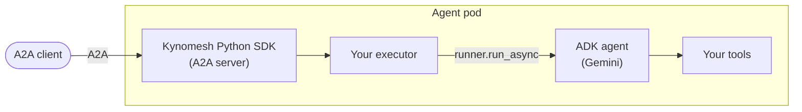

# Running Google ADK Agents on Kynomesh

These tutorials walk you through running agents built with the
[Google Agent Development Kit (ADK)](https://google.github.io/adk-docs/) on
Kynomesh, from a single agent with a custom tool to a supervisor that finds its
workers on its own.

ADK has its own A2A support, but you do not need it here. Kynomesh's Python SDK
runs the [A2A](https://a2a-protocol.org/) server and makes calls between agents,
and your ADK agent is just what answers each message. You describe the
deployment in an [`AgentSet`](../../core-concepts/agentset.md), and Kynomesh
runs the agents and lets them call each other by name.



Multi-agent is not a requirement. A single agent already benefits from
autoscaling, zero-downtime rollouts and rate limiting, and it can grow into a
team later without code changes.

## The Tutorials

Each tutorial builds on the previous one and has a matching, runnable example in
the
[kynoproj/kynomesh-examples](https://github.com/kynoproj/kynomesh-examples/tree/main/google-adk)
repository.

| Tutorial                              | What you build                                                              | What you learn                                                                                               |
| ------------------------------------- | --------------------------------------------------------------------------- | ------------------------------------------------------------------------------------------------------------ |
| [Single agent](./1-single-agent.md)   | A conversational agent with a custom temperature-conversion tool.           | Serving an ADK agent over A2A and deploying it as an `AgentSet`.                                             |
| [Supervisor](./2-supervisor.md)       | A supervisor that delegates to a researcher and a calculator, one pod each. | Splitting work across agents and calling a peer by name.                                                     |
| [Dynamic peers](./3-dynamic-peers.md) | A travel-planning supervisor that finds its workers at startup.             | Adding or removing a worker without changing code, and keeping the supervisor in sync when a worker changes. |

## What to Know About ADK

A few things apply to every tutorial here:

- **The agents run on Gemini.** They call the Gemini API with a `GOOGLE_API_KEY`
  from [Google AI Studio](https://aistudio.google.com/apikey). Set
  `GOOGLE_MODEL` to choose a model; the examples default to `gemini-2.5-flash`.
- **Each request gets a fresh session.** The examples create one in-memory ADK
  session per A2A request, so requests do not share history. For multi-turn
  conversations, switch to a persistent session service and reuse the A2A
  context ID as the session ID.
- **Tools are plain functions.** ADK builds each tool's schema from the
  function's signature and docstring. Describe every argument in the docstring,
  because ADK passes it to the model, and return a dictionary.

## Prerequisites

- Python 3.10+ and [uv](https://docs.astral.sh/uv/)
- A `GOOGLE_API_KEY`
- [`a2acli`](../../user-guide/reference/a2acli.md) to send messages from the
  command line
- Docker, `kubectl`, and a local Kubernetes cluster with Kynomesh installed.
  Follow the [Quick Start](../../quick-start.md) if you have not set one up.

## Get the Examples

```shell
git clone https://github.com/kynoproj/kynomesh-examples.git
cd kynomesh-examples/google-adk
```

Each example is self-contained and works the same way:

| Path / target | Purpose                              |
| ------------- | ------------------------------------ |
| `src/`        | Your agent code and its A2A wrapper. |
| `manifests/`  | The `AgentSet` to deploy.            |
| `tests/`      | Unit tests. They make no API calls.  |
| `make build`  | Build the container image.           |
| `make deploy` | Deploy the `AgentSet`.               |
| `make delete` | Remove it.                           |

## Before You Deploy

- Create the API key secret the manifests read:

  ```shell
  kubectl create secret generic google-api-key --from-literal=GOOGLE_API_KEY=...
  ```

- Load the image into your cluster after `make build`. With kind, run
  `kind load docker-image <image>`; with k3d, run
  `k3d image import <image> -c <cluster>`.

> [!TIP] Behind a TLS-intercepting proxy the image build fails certificate
> checks. Pass the proxy CA with `make build CA_CERT=/path/to/ca.pem`.

## Troubleshooting

- **`no compatible transports found` from `a2acli`:** set `protocol_version` on
  each interface in your agent's `AgentCard`. The examples use
  `PROTOCOL_VERSION_CURRENT` from `a2a.utils.constants`.
- **Pods stay in `ImagePullBackOff` or `CreateContainerConfigError`:** the image
  was not loaded into the cluster, or the `google-api-key` secret is missing.

## Mixing Frameworks

Agents in one `AgentSet` only see each other's `AgentCard`s and A2A endpoints,
so they do not need to use the same framework. See
[Mixing Frameworks and Languages](../mixed-fleet.md) for an example that runs
agents from different frameworks together.

## Next Steps

Start with the [Single agent](./1-single-agent.md) tutorial.
