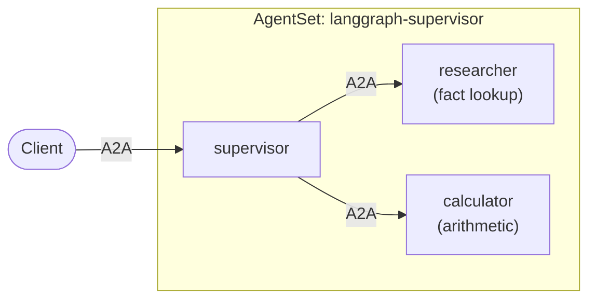

# Tutorial: A Supervisor with Two Workers

In this tutorial you build a team of three
[LangGraph](https://langchain-ai.github.io/langgraph/) agents: a **supervisor**
that takes a question and delegates to two workers, a **researcher** that looks
up facts and a **calculator** that does arithmetic. Each agent runs in its own
pod and the supervisor calls the workers by name.



Splitting work this way lets each agent have a focused prompt and its own tools.
It also lets each one scale independently, so a busy worker can grow while the
others stay small.

This tutorial builds on [Single agent](./1-single-agent.md). The full example is
in
[kynoproj/kynomesh-examples](https://github.com/kynoproj/kynomesh-examples/tree/main/langgraph/supervisor).

```shell
git clone https://github.com/kynoproj/kynomesh-examples.git
cd kynomesh-examples/langgraph/supervisor
```

## What's in the Example

| File                        | Purpose                                                                      |
| --------------------------- | ---------------------------------------------------------------------------- |
| `src/assistant/agents.py`   | The three LangGraph agents.                                                  |
| `src/assistant/tools.py`    | The workers' tools: a small knowledge base and `add`/`multiply`/`divide`.    |
| `src/assistant/peers.py`    | `ask_peer`, which calls another agent by name.                               |
| `src/assistant/executor.py` | Serves a LangGraph agent over A2A, the same wrapper as in the last tutorial. |
| `src/assistant/main.py`     | Starts one agent. `--role` picks which.                                      |
| `manifests/agentset.yaml`   | One image deployed as three agents.                                          |

## The Workers

The workers are ordinary LangGraph agents with a prompt and some tools. They
know nothing about Kynomesh or about the supervisor:

```python
def build_researcher(llm):
    return create_agent(llm, RESEARCHER_TOOLS, system_prompt=RESEARCHER_PROMPT)


def build_calculator(llm):
    return create_agent(llm, CALCULATOR_TOOLS, system_prompt=CALCULATOR_PROMPT)
```

The researcher's only tool, `lookup_fact`, reads from a tiny built-in knowledge
base covering France, Japan, Kubernetes and A2A. The calculator has `add`,
`multiply` and `divide`.

> [!NOTE] Ask the researcher about anything outside that knowledge base and it
> answers "No facts found". The tool is a stand-in for a real search or
> database.

## The Supervisor

The supervisor is also a normal LangGraph agent. Its tools are the workers: each
tool forwards a question to a worker by name.

```python
@tool
async def ask_researcher(question: str) -> str:
    """Ask the researcher worker a factual question."""
    return await ask_peer("researcher", question)


@tool
async def ask_calculator(problem: str) -> str:
    """Ask the calculator worker to solve an arithmetic problem."""
    return await ask_peer("calculator", problem)
```

Its prompt tells it to delegate rather than answer itself, and to call both
workers in turn when a question needs both:

```python
SUPERVISOR_PROMPT = (
    "You are a supervisor with two workers: the researcher (facts) and the calculator "
    "(arithmetic). Delegate with the ask_researcher and ask_calculator tools; call both, "
    "one after the other, when a question needs both. Never answer facts or math yourself. "
    "Finish with a short final answer."
)
```

## Calling a Peer by Name

`ask_peer` is the only place the agents talk to each other. It asks the Kynomesh
SDK for a client for the peer and sends it a message:

```python
async def ask_peer(name: str, text: str) -> str:
    a2a_client = await client.peer_client(name)
    request = SendMessageRequest(
        message=Message(
            message_id=str(uuid.uuid4()),
            role=Role.ROLE_USER,
            parts=[Part(text=text)],
        )
    )
    chunks: list[str] = []
    async for response in a2a_client.send_message(request):
        chunks.extend(part.text for part in response.message.parts)
    return "".join(chunks)
```

`name` is the agent's name in the `AgentSet`, such as `researcher`. There are no
URLs, ports or service names in your code.

## One Image, Three Agents

All three agents come from the same image. `main.py` reads a `--role` argument
and builds the matching graph and `AgentCard`:

```python
def build_graph(role: str):
    llm = agents.build_llm()
    if role == "supervisor":
        return agents.build_supervisor(llm, ask_peer)
    if role == "researcher":
        return agents.build_researcher(llm)
    if role == "calculator":
        return agents.build_calculator(llm)
```

Sharing one image keeps the example simple. In your own project each agent can
have its own image, and even its own language.

## The AgentSet

The manifest declares the three agents and how they relate:

```yaml
apiVersion: kynomesh.kyno.sh/v1alpha1
kind: AgentSet
metadata:
  name: langgraph-supervisor
spec:
  pattern: Supervisor
  entry: supervisor
  agents:
    - name: supervisor
      container:
        image: langgraph-supervisor:latest
        imagePullPolicy: IfNotPresent
        args: ["--role", "supervisor"]
        env: &openai-env
          - name: OPENAI_API_KEY
            valueFrom:
              secretKeyRef:
                name: openai-api-key
                key: OPENAI_API_KEY
    - name: researcher
      container:
        image: langgraph-supervisor:latest
        imagePullPolicy: IfNotPresent
        args: ["--role", "researcher"]
        env: *openai-env
    - name: calculator
      container:
        image: langgraph-supervisor:latest
        imagePullPolicy: IfNotPresent
        args: ["--role", "calculator"]
        env: *openai-env
```

Two fields shape the team:

- `entry: supervisor` makes the supervisor the agent that outside callers reach.
- `pattern: Supervisor` lets the entry agent call every other agent, while the
  workers can call no one. That is why `ask_peer("researcher", ...)` works in
  the supervisor and would not work in a worker.

Kynomesh also supports
[other patterns](../../core-concepts/agentset.md#patterns) such as `Handoff` and
`Sequential`.

## Run the Tests

```shell
uv run pytest
```

The tests mock the LLM and the calls between agents, so they need no API key or
cluster.

> [!NOTE] The supervisor can only reach its workers on Kynomesh, so you cannot
> try the whole team on your laptop. A single worker does run locally:
>
> ```shell
> OPENAI_API_KEY=... uv run python -m assistant.main --role calculator
> a2acli -u http://localhost:8088 send 'What is 68 * 3?'
> ```

## Deploy to Kynomesh

Build the image, load it into your cluster, create the secret, and deploy:

```shell
make build
# kind:  kind load docker-image langgraph-supervisor:latest
# k3d:   k3d image import langgraph-supervisor:latest -c <cluster>
kubectl create secret generic openai-api-key --from-literal=OPENAI_API_KEY=...
make deploy
```

Wait until the `AgentSet` is `Running` and the three agents are ready:

```shell
kubectl get agentset,agentdeploy
```

## Talk to the Team

Forward the entry agent's service to your machine:

```shell
kubectl port-forward svc/langgraph-supervisor-ingress 8490
```

First ask something that needs one worker:

```shell
a2acli -k -u https://localhost:8490 --override-host=localhost:8490 \
  send 'What is the capital of France?'
```

The supervisor asks the researcher and replies with Paris. Then ask something
that needs both:

```shell
a2acli -k -u https://localhost:8490 --override-host=localhost:8490 \
  send 'What is the population of France multiplied by 3?'
```

The supervisor asks the researcher for France's population (about 68 million),
then asks the calculator to multiply it by 3.

To see the delegation happen, watch the workers' logs while you send the second
question:

```shell
kubectl get pods
kubectl logs -f <researcher-pod> -c agent
```

## Clean Up

```shell
make delete
```

## Make It Your Own

- **Change the workers.** Replace the tools in `tools.py`, or the whole worker
  graph, with your own. The supervisor only needs a tool that calls the worker
  by name.
- **Add a worker.** Add an agent to the `AgentSet`, give the supervisor a tool
  that calls it, and update the supervisor's prompt. The next tutorial,
  [Dynamic peers](./3-dynamic-peers.md), removes even that last step.
- **Scale one agent.** Workers scale independently of the supervisor. See
  [Autoscaling](../../user-guide/reference/autoscaling.md).

## Troubleshooting

- **The supervisor answers "No facts found":** the researcher's knowledge base
  only covers France, Japan, Kubernetes and A2A. Ask about one of those.
- **`no compatible transports found`:** every `AgentInterface` in each agent's
  card needs `protocol_version` set.
- **An agent is not ready:** run `kubectl get pods` and check the image was
  loaded into the cluster and the `openai-api-key` secret exists.

## Next Steps

The supervisor in this tutorial names its workers in code. In the next tutorial
it discovers them instead.
