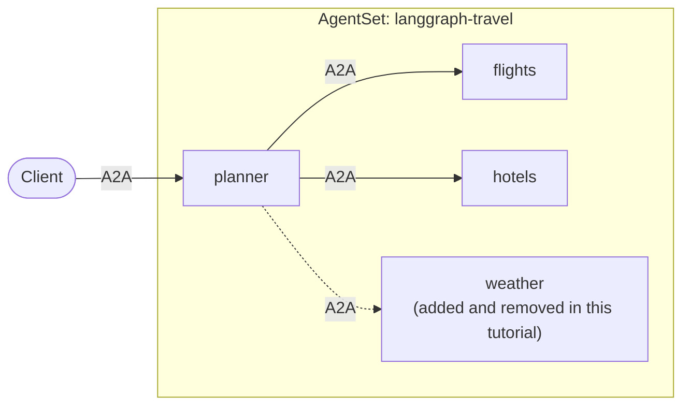

# Tutorial: A Supervisor That Discovers Its Workers

In the [previous tutorial](./2-supervisor.md) the supervisor had a hard-coded
tool for each worker. Adding a worker meant editing code and rebuilding the
image. Here you build a travel-planning supervisor whose workers are **not named
in its code**. At startup it asks Kynomesh who its workers are, reads what each
one can do, and builds its tools from that.

The result: add or remove a worker in the `AgentSet` and the supervisor picks it
up, with no code change and no new image.



The entry agent is named `planner`. With `pattern: Supervisor` it acts as the
supervisor: it sees every other agent and delegates to them.

The full example is in
[kynoproj/kynomesh-examples](https://github.com/kynoproj/kynomesh-examples/tree/main/langgraph/dynamic-peers).

```shell
git clone https://github.com/kynoproj/kynomesh-examples.git
cd kynomesh-examples/langgraph/dynamic-peers
```

## What's in the Example

| File                                   | Purpose                                                                                                     |
| -------------------------------------- | ----------------------------------------------------------------------------------------------------------- |
| `src/travel/discovery.py`              | Finds the supervisor's workers and reads each one's `AgentCard`.                                            |
| `src/travel/supervisor.py`             | Builds one tool per worker, and the prompt's worker list, from those cards.                                 |
| `src/travel/workers.py`                | The worker roles the image can run: `flights`, `hotels` and `weather`. Also the extra skills they can gain. |
| `src/travel/main.py`                   | Starts the supervisor or a worker. `--role` picks which.                                                    |
| `manifests/agentset.yaml`              | The supervisor, `flights` and `hotels`.                                                                     |
| `manifests/agentset-with-weather.yaml` | The same, plus `weather`.                                                                                   |

The workers use stub tools with canned data, so the example needs no travel API.

## How Discovery Works

An agent's `AgentCard` describes what it is and what it can do. Each worker
already publishes one, so the supervisor can learn about its workers by reading
their cards instead of being told about them.

`discovery.py` lists the supervisor's peers, then reads each peer's card:

```python
async def discover_workers() -> tuple[WorkerInfo, ...]:
    workers = []
    for name in sorted(client.peers()):
        card = await client.resolve_agent_card(name)
        workers.append(WorkerInfo(
            name=name,
            description=card.description,
            skills=tuple((s.name, s.description) for s in card.skills),
        ))
    return tuple(workers)
```

`client.peers()` returns the agents the supervisor is allowed to call, and
`client.resolve_agent_card(name)` returns a peer's card. Nothing in this code
names a worker. Every agent in the `AgentSet` starts at the same time, so a
worker is often still starting when the supervisor looks for it. The version in
the example retries each worker for about a minute. If one is still unreachable,
the supervisor exits with an error and Kubernetes restarts the pod, which tries
again. So the supervisor never serves with a worker missing.

## Building Tools from Cards

`supervisor.py` turns each discovered worker into a tool whose description comes
from the worker's card:

```python
def peer_tools(workers, ask_peer):
    def make(worker):
        async def delegate(request: str) -> str:
            try:
                return await ask_peer(worker.name, request)
            except Exception as e:  # the model should see a failed worker, not fail the request
                return f"Error: worker {worker.name!r} failed: {e}"

        return StructuredTool.from_function(
            coroutine=delegate,
            name=tool_name(worker.name),      # e.g. "ask_flights"
            description=describe(worker),     # the card's description and skills
        )

    return [make(w) for w in workers]
```

If a worker fails, the tool returns an error string to the model instead of
raising. The supervisor can then answer around the failure rather than failing
the request.

The prompt is generated the same way, with one line per worker:

```text
You are a travel-planning supervisor. ...
Your workers:
- ask_flights: Finds flights between cities. Skills: Search flights: Flight options with times and prices.
- ask_hotels: Finds hotels in a city. Skills: Search hotels: Hotel options with nightly prices.
```

Because the model chooses tools from these descriptions, **the quality of a
worker's `AgentCard` now matters**. A clear description and skills are what let
the supervisor route requests correctly.

If a request needs a worker that does not exist, the prompt tells the supervisor
to say so plainly rather than guess.

## The AgentSet

The base manifest deploys the supervisor with `flights` and `hotels`, and turns
on `driftReload`:

```yaml
apiVersion: kynomesh.kyno.sh/v1alpha1
kind: AgentSet
metadata:
  name: langgraph-travel
spec:
  pattern: Supervisor
  entry: planner
  driftReload:
    enabled: true
  agents:
    - name: planner
      container:
        image: langgraph-travel:latest
        imagePullPolicy: IfNotPresent
        args: ["--role", "planner"]
        env: &openai-env
          - name: OPENAI_API_KEY
            valueFrom:
              secretKeyRef:
                name: openai-api-key
                key: OPENAI_API_KEY
    - name: flights
      container:
        image: langgraph-travel:latest
        imagePullPolicy: IfNotPresent
        args: ["--role", "flights"]
        env: *openai-env
    - name: hotels
      container:
        image: langgraph-travel:latest
        imagePullPolicy: IfNotPresent
        args: ["--role", "hotels"]
        env: *openai-env
```

`pattern: Supervisor` lets the supervisor see every other agent, which is what
`client.peers()` returns. `driftReload` is explained
[below](#change-a-workers-card-drift-reload).

## Run the Tests

```shell
uv run pytest
```

The tests mock the LLM and the calls between agents. Like the previous example,
the supervisor only runs on Kynomesh, while a worker runs locally:

```shell
OPENAI_API_KEY=... uv run python -m travel.main --role flights
```

## Deploy to Kynomesh

```shell
make build
# kind:  kind load docker-image langgraph-travel:latest
# k3d:   k3d image import langgraph-travel:latest -c <cluster>
kubectl create secret generic openai-api-key --from-literal=OPENAI_API_KEY=...
make deploy
kubectl get agentset,agentdeploy
kubectl port-forward svc/langgraph-travel-ingress 8490
```

> [!NOTE] The supervisor waits for its workers, which start at the same time as
> it does. If a worker is not reachable within about a minute, the supervisor
> exits and Kubernetes restarts it. You may see it restart while the workers
> come up; that is not a failure.

The supervisor logs the workers it found at startup:

```shell
kubectl logs -l app.kubernetes.io/name=langgraph-travel-planner -c agent | grep discovered
```

Ask it to plan a trip:

```shell
a2acli -k -u https://localhost:8490 --override-host=localhost:8490 \
  send 'Plan a weekend in Tokyo: flights from SFO and a hotel'
```

The supervisor uses the flights and hotels workers. Now ask the same thing and
add a weather check, which no worker can do yet:

```shell
a2acli -k -u https://localhost:8490 --override-host=localhost:8490 \
  send 'Plan a weekend in Tokyo: flights from SFO and a hotel, and check the weather'
```

The supervisor covers the flights and the hotel, and tells you it has no worker
that can check the weather.

## Add and Remove a Worker with No Code Change

Apply the manifest that adds the `weather` worker:

```shell
kubectl apply -f manifests/agentset-with-weather.yaml
kubectl get pods -w
```

The new `weather` pod starts, and the supervisor's pod restarts. Kynomesh
restarts it because its set of workers changed, and on startup it waits for all
three workers to be reachable, then discovers them:

```shell
kubectl logs -l app.kubernetes.io/name=langgraph-travel-planner -c agent | grep discovered
```

Ask the same question again. This time the weather is included:

```shell
a2acli -k -u https://localhost:8490 --override-host=localhost:8490 \
  send 'Plan a weekend in Tokyo: flights from SFO and a hotel, and check the weather'
```

The two manifests differ only by the added `weather` agent. The supervisor's
code and image are identical. Now remove the worker again by applying the base
manifest. The supervisor restarts and goes back to two workers:

```shell
kubectl apply -f manifests/agentset.yaml
kubectl get pods -w
```

Ask once more, with the weather check. With no weather worker, the supervisor
says so again:

```shell
a2acli -k -u https://localhost:8490 --override-host=localhost:8490 \
  send 'Plan a weekend in Tokyo: flights from SFO and a hotel, and check the weather'
```

## Change a Worker's Card: Drift Reload

Discovery has one gap. The supervisor reads each worker's card once, at startup,
and builds its tools and prompt from it. If a worker later gains a skill, the
supervisor would keep describing it the old way until something restarted it.

[`driftReload`](../../user-guide/reference/drift-reload.md) closes that gap.
When a worker's `AgentCard` changes, Kynomesh restarts the agents still holding
the stale copy, so the supervisor rebuilds its tools from the new card.

To try it, the workers read an optional `EXTRA_SKILLS` environment variable that
turns on extra skills. The `amenities` skill gives the `hotels` worker a new
tool, `hotel_amenities`, backed by new data, and puts the skill on its card. It
stands in for shipping a new version of an agent that gained a capability.

First, ask for a trip and add a breakfast check, which the `hotels` worker can't
answer yet:

```shell
a2acli -k -u https://localhost:8490 --override-host=localhost:8490 \
  send 'Plan a weekend in Tokyo: flights from SFO and a hotel, and check if the hotels have breakfast'
```

The supervisor covers the flights and hotels, but can't say whether the hotels
have breakfast. Now turn the skill on for `hotels`:

```shell
kubectl patch agentset langgraph-travel --type=json -p='[
  {"op":"add","path":"/spec/agents/2/container/env/-",
   "value":{"name":"EXTRA_SKILLS","value":"amenities"}}]'
```

`/spec/agents/2` is `hotels`, the third entry in the manifest. Once the `hotels`
pods roll, Kynomesh sees that its card changed and restarts the supervisor. Its
`ask_hotels` tool now lists the new skill.

**Give it a few minutes.** The supervisor does not restart as soon as the
`hotels` pods are back, and that is expected, not a failure. Kynomesh waits for
the changed card to stay stable, and for the rollout to finish, before it
restarts the supervisor.

```shell
kubectl get pods -w                    # the supervisor restarts after a few minutes
```

Check the supervisor pod's age to confirm the restart. For the mechanism, see
the
[AgentCard drift detection spec](../../development/specifications/agentcard-drift-reload.md).

Ask the same question again. The supervisor's `ask_hotels` tool now advertises
the skill, and the `hotels` worker answers from its new tool, so the plan covers
breakfast too: Park Hyatt Tokyo includes it, and Shinjuku Granbell does not (it
is a $15 add-on).

```shell
a2acli -k -u https://localhost:8490 --override-host=localhost:8490 \
  send 'Plan a weekend in Tokyo: flights from SFO and a hotel, and check if the hotels have breakfast'
```

> [!NOTE] `driftReload` is off by default because it restarts pods
> automatically. Enable it for the agents that depend on other agents' cards, as
> this manifest does.

## Clean Up

```shell
make delete
```

## Make It Your Own

- **Write good cards.** The supervisor routes by each worker's description and
  skills, so describe what your workers do and when to use them.
- **Use any workers.** They do not need to share the supervisor's image or
  language. Anything that serves an `AgentCard` over A2A and is in the
  `AgentSet` is discovered the same way.
- **Know what discovery covers.** The supervisor's worker list is read at
  startup, and Kynomesh restarts it when workers are added or removed, or when
  `driftReload` detects a changed card.

## Troubleshooting

- **The supervisor keeps restarting:** it exits if a worker is still unreachable
  after about a minute, and Kubernetes restarts it. Run `kubectl get pods` to
  see whether the worker is running, and read the supervisor's logs. You will
  see `not reachable yet` lines for the worker, then an error saying it was
  unreachable after the last attempt.
- **The supervisor says it has no workers:** the `AgentSet` has no other agents
  for it to call. Check the manifest.
- **A new worker is not picked up:** check that it is in the `AgentSet` and that
  the supervisor pod restarted after you applied the manifest.
- **A changed card is not picked up:** check that `driftReload` is enabled, and
  give it a few minutes. The restart waits for the card to stay stable and for
  the rollout to finish.
- **A worker fails to start after you set `EXTRA_SKILLS`:** the only skill
  available is `amenities`. Any other value makes the worker exit with an
  `unknown extra skill` error.
- **A worker error appears in the answer:** the supervisor reports a failed
  worker instead of failing the request. Check that worker's logs with
  `kubectl logs`.
- **`no compatible transports found`:** every `AgentInterface` in each agent's
  card needs `protocol_version` set.

## Next Steps

You have now run a single agent, a supervisor with fixed workers, and a
supervisor that discovers its workers. For other ways to wire agents together,
see the [AgentSet patterns](../../core-concepts/agentset.md#patterns), and for
tuning a running team, see
[Autoscaling](../../user-guide/reference/autoscaling.md).
