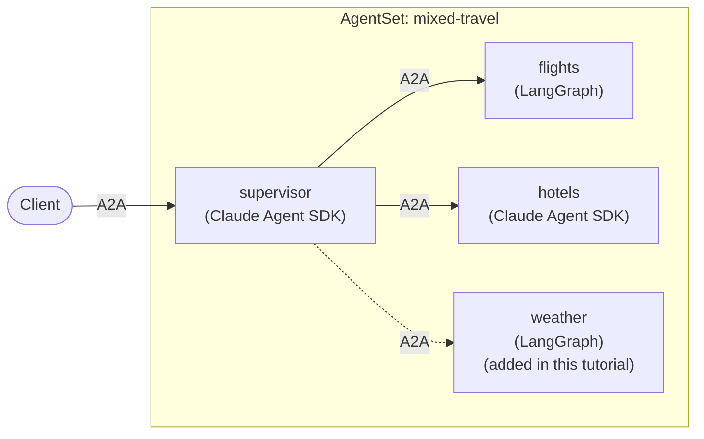

# Tutorial: Mixing Frameworks and Languages

Real teams rarely standardize on one agent framework. One group builds with
LangGraph, another with the Claude Agent SDK, and a third wants to write in Go.
Kynomesh does not ask them to agree. Agents in an
[`AgentSet`](../core-concepts/agentset.md) only see each other's `AgentCard`s
and [A2A](https://a2a-protocol.org/) endpoints, so each agent can use whatever
framework, and whatever language, suits it.

In this tutorial you deploy one `AgentSet` whose agents are built with different
frameworks, and see that the supervisor neither knows nor cares which is which.



The full example is in
[kynoproj/kynomesh-examples](https://github.com/kynoproj/kynomesh-examples/tree/main/mixed-fleet).
It builds on the two Dynamic peers tutorials, so read
[LangGraph](./langgraph/3-dynamic-peers.md) and
[Claude Agent SDK](./claude-agent-sdk/2-dynamic-peers.md) first if you have not.

```shell
git clone https://github.com/kynoproj/kynomesh-examples.git
cd kynomesh-examples/mixed-fleet
```

## Why It Works

Agents in a Kynomesh `AgentSet` talk to each other over A2A, an open protocol. A
caller needs three things from a peer: its name, its `AgentCard`, and an
endpoint that speaks A2A. It needs nothing about how the peer is built.

- **Frameworks.** LangGraph and the Claude Agent SDK do not speak A2A
  themselves. In each case a small wrapper serves the agent over A2A, as you saw
  in the single-agent tutorials. From outside the pod, the two look the same.
- **Languages.** Kynomesh provides SDKs for
  [Python and Go](../user-guide/sdks/overview.md), and any language with an A2A
  implementation can run on Kynomesh. The SDKs save you the wiring, but they are
  optional.
- **Discovery.** A supervisor that
  [discovers its workers](../user-guide/sdks/overview.md#discovering-peers-dynamically)
  from their cards treats every worker the same way, whichever framework or
  language produced it.

## What's in the Example

There is no new agent code. The manifests reuse the images built by the two
Dynamic peers examples, choosing the framework per agent with `image`, and the
role with `--role`:

| Agent                | Framework        | Image              | Built from                                                                                                                 |
| -------------------- | ---------------- | ------------------ | -------------------------------------------------------------------------------------------------------------------------- |
| `supervisor`         | Claude Agent SDK | `claude-travel`    | [`claude-agent-sdk/dynamic-peers`](https://github.com/kynoproj/kynomesh-examples/tree/main/claude-agent-sdk/dynamic-peers) |
| `hotels`             | Claude Agent SDK | `claude-travel`    | [`claude-agent-sdk/dynamic-peers`](https://github.com/kynoproj/kynomesh-examples/tree/main/claude-agent-sdk/dynamic-peers) |
| `flights`, `weather` | LangGraph        | `langgraph-travel` | [`langgraph/dynamic-peers`](https://github.com/kynoproj/kynomesh-examples/tree/main/langgraph/dynamic-peers)               |

| File                                   | Purpose                                       |
| -------------------------------------- | --------------------------------------------- |
| `manifests/agentset.yaml`              | The supervisor, `flights` and `hotels`.       |
| `manifests/agentset-with-weather.yaml` | The same, plus a LangGraph `weather` worker.  |
| `Makefile`                             | Builds both images and deploys the manifests. |

## The AgentSet

Each agent names its own image and the key its framework needs. The excerpt
below shows the supervisor and `flights`:

```yaml
apiVersion: kynomesh.kyno.sh/v1alpha1
kind: AgentSet
metadata:
  name: mixed-travel
spec:
  pattern: Supervisor
  entry: supervisor
  driftReload:
    enabled: true
  agents:
    - name: supervisor # Claude Agent SDK
      container:
        image: claude-travel:latest
        imagePullPolicy: IfNotPresent
        args: ["--role", "supervisor"]
        env:
          - name: ANTHROPIC_API_KEY
            valueFrom:
              secretKeyRef:
                name: anthropic-api-key
                key: ANTHROPIC_API_KEY
    - name: flights # LangGraph
      container:
        image: langgraph-travel:latest
        imagePullPolicy: IfNotPresent
        args: ["--role", "flights"]
        env:
          - name: OPENAI_API_KEY
            valueFrom:
              secretKeyRef:
                name: openai-api-key
                key: OPENAI_API_KEY
    # hotels (Claude Agent SDK) follows the same shape as the supervisor
```

The frameworks differ per agent, and so do their secrets: the Claude agents get
only `ANTHROPIC_API_KEY`, and the LangGraph agents get only `OPENAI_API_KEY`.
Everything else, `pattern`, `entry` and `driftReload`, is the same as in a
single-framework `AgentSet`.

## Deploy to Kynomesh

You need both an `ANTHROPIC_API_KEY` and an `OPENAI_API_KEY`, because the fleet
contains both kinds of agent.

```shell
make build                     # builds langgraph-travel and claude-travel
# kind:  kind load docker-image langgraph-travel:latest claude-travel:latest
# k3d:   k3d image import langgraph-travel:latest claude-travel:latest -c <cluster>
kubectl create secret generic anthropic-api-key --from-literal=ANTHROPIC_API_KEY=...
kubectl create secret generic openai-api-key --from-literal=OPENAI_API_KEY=...
make deploy
kubectl get agentset,agentdeploy
kubectl port-forward svc/mixed-travel-ingress 8490
```

The supervisor logs the workers it found, and the pods show which image each
agent runs:

```shell
kubectl logs -l app.kubernetes.io/name=mixed-travel-supervisor -c agent | grep discovered
kubectl get pods -o custom-columns='POD:.metadata.name,IMAGE:.spec.initContainers[?(@.name=="agent")].image'
```

Ask it to plan a trip:

```shell
a2acli -k -u https://localhost:8490 --override-host=localhost:8490 \
  send 'Plan a weekend in Tokyo: flights from SFO and a hotel'
```

The answer combines `flights`, a LangGraph agent, and `hotels`, a Claude agent,
through a Claude supervisor.

## Add a LangGraph Worker to a Claude Supervisor

Apply the manifest that adds the LangGraph `weather` worker:

```shell
kubectl apply -f manifests/agentset-with-weather.yaml
kubectl get pods -w
```

As in the earlier tutorials, the supervisor restarts and discovers all three
workers. Ask the weather question:

```shell
kubectl logs -l app.kubernetes.io/name=mixed-travel-supervisor -c agent | grep discovered
a2acli -k -u https://localhost:8490 --override-host=localhost:8490 \
  send 'What is the weather in Tokyo this weekend?'
```

The supervisor's code and image did not change, and it did not need to learn
about LangGraph. To remove the worker, apply `manifests/agentset.yaml` again.

## Clean Up

```shell
make delete
```

## Bringing In Another Language

The example mixes frameworks, and both are Python. The same approach works for
other languages, because the only contract is A2A:

- **Go.** Use the [Kynomesh Go SDK](https://github.com/kynoproj/kynomesh-go) to
  serve a Go agent and to call peers by name with `client.PeerClient`. It
  provides the same server and client halves as the Python SDK. See
  [SDKs](../user-guide/sdks/overview.md).
- **Anything else.** Serve an A2A endpoint that publishes an `AgentCard`, and
  package it as a container image. Kynomesh runs it like any other agent, and
  other agents discover it through its card. Without an SDK you handle the
  wiring the SDKs normally do for you.

Then add it to the `AgentSet` with its own `image`. A supervisor that discovers
its workers picks it up like any other.

> [!NOTE] Calls to a peer go through Kynomesh by name, so the language of the
> caller and the callee never needs to match. A Python supervisor can delegate
> to a Go worker, and the reverse.

## Make It Your Own

- **Pick the framework per agent.** Use each framework where it is strongest,
  and let the `AgentSet` connect them.
- **Keep cards accurate.** Discovery relies on each worker's description and
  skills, so write them carefully, whatever the framework.
- **Keep secrets separate.** Give each agent only the keys its framework needs,
  as the manifest does.

## Troubleshooting

- **A pod fails with `CreateContainerConfigError`:** one of the two secrets is
  missing. The fleet needs both `anthropic-api-key` and `openai-api-key`.
- **`ImagePullBackOff`:** both images must be loaded into your cluster, not just
  one.
- **The supervisor does not mention a worker:** check its `discovered` log line
  and that the worker's pod is running.
- **`no compatible transports found`:** every `AgentInterface` in each agent's
  card needs `protocol_version` set.

## Next Steps

For calling an agent that lives in another `AgentSet`, see
[External Agents](../user-guide/reference/configuration/external-agents.md) and
the
[external-agent](https://github.com/kynoproj/kynomesh-examples/tree/main/external-agent)
example.
